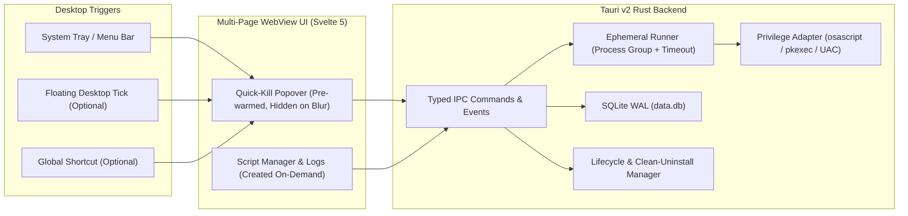

# KillEverything — System & Architecture Design

## 1. Product Overview & Non-Goals

**KillEverything** (`com.killeverything.app`) is a lightweight, cross-platform desktop utility for **macOS, Windows, and Linux** built to let users trigger their own process-killing scripts in one or two clicks instead of opening Activity Monitor, Task Manager, or System Monitor.

### Core Principles & Boundaries
- **Strict Script Ownership (No Auto-Generation)**: KillEverything **never generates**, guesses, or modifies kill scripts on behalf of the user. Users author, paste, and maintain their own shell scripts; the application stores, organizes, and executes them rapidly.
- **Ultra-Lightweight Footprint**: Targets near-zero idle CPU (`~0%`), compact native installers (`~4–8 MB`), `< 50ms` Quick-Kill dropdown open latency, and immediate memory reclamation for non-pinned management views.
- **Zero-Trace Uninstall**: 100% of persistent files (SQLite database, WAL files, WebView2/WebKit caches, execution temp files, autostart entries) are strictly isolated under deterministic app directories and cleanly removed on uninstall across Windows, macOS, and Linux.

### Non-Goals
- No built-in process explorer, CPU/RAM profiler, or automated process-killing heuristics.
- No credential vault or stored `sudo`/admin passwords (privilege elevation is always delegated to native OS prompts).
- No cloud sync or telemetry (offline local SQLite + manual JSON import/export).

---

## 2. Architecture & Performance Strategy

### Tech Stack
| Layer | Selection | Rationale |
|---|---|---|
| **Application Framework** | **Tauri v2** (Rust Core) | Native system tray, frameless/always-on-top windows, small binary footprint, built-in cross-OS bundlers. |
| **Frontend UI** | **Svelte 5 + TypeScript + Plain CSS** | Zero heavy runtime overhead; multi-page Vite build keeps the Quick-Kill Popover JS bundle `< 15 KB` gzipped. |
| **Database** | **SQLite** via `rusqlite` (`bundled` + WAL) | Statically linked into the Rust binary with zero system dependencies and sub-millisecond reads. |
| **Execution Engine** | Rust `tokio::process` + Native Elevation | Async non-blocking spawns, process-group/Job-Object timeouts, hidden Windows consoles, OS privilege prompts. |
| **Installers & Bundlers** | NSIS (`.exe`), `.dmg` / `.pkg`, `.deb` / `.rpm` | Native per-OS installation and lifecycle uninstall hooks. |



### 3-Tier Window & Memory Lifecycle
Keeping multiple WebViews loaded continuously wastes RAM. KillEverything uses a strict 3-tier window lifecycle paired with multi-page Vite entry points (`tick.html`, `popover.html`, `manager.html`):

1. **System Tray / Menu Bar Icon (Native OS API, `~0 MB` UI overhead)**
   - **Left-click**: Toggles the `popover` dropdown anchored neatly next to the tray icon.
   - **Right-click**: Native OS context menu listing Pinned scripts (1-click instant kill directly from the native menu), *Toggle Floating Tick*, *Manage Scripts*, and *Quit*.
2. **Floating Desktop Tick (`tick` window — `40×40px`, optional)**
   - Frameless, transparent, `always_on_top: true`, `skip_taskbar: true`, non-focus-stealing badge.
   - Instantiated only when `show_floating_tick` is enabled; destroyed immediately when toggled off.
3. **Quick-Kill Popover (`popover` window — `320×420px`) & Script Manager (`manager` window — `680×520px`)**
   - `popover` stays hidden (`hide()`) after initial warm-up for `< 50ms` response and automatically hides when losing focus (`on_window_event(Focused(false))`).
   - `manager` (editor, execution log viewer, settings) is **created strictly on demand and destroyed (`close()`) on exit**, releasing editor DOM/CSS/JS memory completely when idle.

### Platform Window Behavior
- **macOS**: Runs as `ActivationPolicy::Accessory` (hidden from Dock and `Cmd+Tab` switcher). Floating Tick and Popover use `NSPanel` / `NSWindowCollectionBehavior` (`CanJoinAllSpaces | FullScreenAuxiliary | Stationary`) so the tick remains visible across Spaces and full-screen apps without stealing focus.
- **Windows**: Applies extended styles `WS_EX_TOOLWINDOW | WS_EX_NOACTIVATE` to the Floating Tick so clicking or hovering never steals focus from the active foreground window or appears in `Alt+Tab`.
- **Linux**: Pure Wayland compositors disallow arbitrary global `(x, y)` positioning for regular windows. KillEverything uses `gtk-layer-shell` where supported or falls back to X11/XWayland (`GDK_BACKEND=x11`) for Floating Tick positioning, while always keeping the `libayatana-appindicator` System Tray and Global Shortcut active as universal primary triggers.

---

## 3. UI / UX Specification

### A. Floating Desktop "Tick"
- **Visual Design**: `40×40px` crisp circular/squircle badge; `45%` opacity when idle (configurable), smoothly transitioning to `100%` on hover, with subtle spinner/pulse states while a script runs.
- **Interactions**:
  - **Left-click** (`pointerdown` -> `pointerup` with `< 4px` drag delta): Opens the Quick-Kill Popover anchored adjacent to the tick (auto-flips up/down/left/right near display edges).
  - **Drag** (`>= 4px` pointer movement): Moves freely across monitors; magnetically snaps to screen edges within a `16px` threshold on release and saves `(x, y, monitor_id)` in SQLite.
  - **Right-click**: Opens native menu (*Manage Scripts*, *Hide Tick*, *Quit*).

### B. Quick-Kill Popover Widget (`320 × max 420px`)
```text
┌──────────────────────────────────────────┐
│ 🔍 Filter scripts...          [+ New] [⚙]│
├──────────────────────────────────────────┤
│ 📌 Chrome & Helpers       [bash]   [Kill]│
│ 📌 Docker Desktop    [⚡sudo·zsh]   [Kill]│
├──────────────────────────────────────────┤
│    Android Studio + ADB   [bash]   [Kill]│
│    Node / Vite Ports      [bash]  [✓ 80ms]│
│    Stuck Zoom        [pwsh] [⚠ Log] [Kill]│
└──────────────────────────────────────────┘
```
- **Instant Filtering & Keyboard Flow**: Opening focuses the search box; `↑` / `↓` selects a script, `Enter` triggers execution, `Esc` dismisses the popover.
- **Inline Status Feedback**: Clicking **[Kill]** immediately triggers execution (or shows an inline *"Confirm? [Yes] [Cancel]"* strip if `confirm_before_run` is enabled). Button transitions `Kill` -> `Spinner` -> `✓ 80ms` or `⚠ Exit N · Log`.
- **Failure Output Drawer**: Clicking `⚠ Log` expands a compact inline drawer displaying `exit_code`, `duration_ms`, and truncated `stderr`/`stdout` without needing to open the full Manager window.
- **Auto-Close Option**: Controlled via `close_popover_on_kill` setting (triggers after brief confirmation flash or immediately if no error occurred).

### C. Script Manager & Log Viewer (`680 × 520px`, On-Demand)
- **Tab 1 — Scripts**:
  - Left list: Searchable, pinnable, drag-reorderable script list + `+ New Script` + `Duplicate` + `Delete`.
  - Right editor:
    - **Name** & **Icon** picker (minimal curated icons).
    - **Shell Selector** (filtered dynamically to shells detected on the host OS, plus custom binary path option).
    - **Working Directory** (optional; defaults to user home directory).
    - **Script Editor** (monospaced textarea — stores exact user-written bytes unmodified).
    - **Toggles**: `Run Elevated (Admin / sudo)`, `Ask confirmation before running`, `Timeout (seconds)` (default `15s`).
    - **[Test Run]** button: Saves/runs draft immediately and renders live `stdout`, `stderr`, exit code, and duration inside the editor panel.
- **Tab 2 — Execution Logs**:
  - Filterable recent history (capped at 10 runs per script via SQLite trigger) showing timestamp, exit status, duration, and full captured `stdout`/`stderr`.
- **Tab 3 — Settings & Uninstall**:
  - Toggle Floating Tick (`show_floating_tick`), Idle Opacity, Global Hotkey recorder, Launch at Login (`tauri-plugin-autostart`), Close Popover after Kill.
  - **Backup**: Export all scripts to JSON / Import JSON (`merge` or `replace`).
  - **Clean Uninstall**: *Uninstall & Wipe All App Data* action (two-step confirmation).

---

## 4. Script Execution & Privilege Elevation Engine

### Shell Execution Matrix
| OS | Selectable Shells (`shell_type`) | Invocation Strategy |
|---|---|---|
| **macOS** | `sh`, `bash`, `zsh`, `custom` | `<shell_bin> <ephemeral_script.sh>` (`chmod 0700`) |
| **Linux** | `sh`, `bash`, `zsh`, `custom` | `<shell_bin> <ephemeral_script.sh>` (`chmod 0700`) |
| **Windows** | `powershell`, `pwsh`, `cmd`, `git_bash`, `wsl`, `custom` | Spawned with `CREATE_NO_WINDOW` (`0x08000000`) running `.ps1` (`-NoProfile -NonInteractive -ExecutionPolicy Bypass -File`), `.cmd` (`/d /c`), or `.sh` (`bash.exe` / `wsl.exe -e bash`) |

### Execution Safety & Ephemeral Lifecycle
1. **Ephemeral Script Materialization**: Raw script text from SQLite is written to `<app_cache_dir>/run/exec_<uuid>.<ext>` with `0700` permissions (Unix) immediately before launch. A Rust RAII `Drop` guard guarantees deletion even if the task panics, fails, or times out.
2. **Environment Isolation & Guard**:
   - Working directory defaults to the user's home directory (or `working_dir` if configured).
   - Injects `KILL_EVERYTHING_PID=<current_pid>` so users can safely exclude KillEverything from broad pattern kills if desired.
3. **Process-Group Timeout & Bounded Output**:
   - **Unix**: Spawned in its own session/process group (`process_group(0)`). On timeout (`timeout_secs`, default `15s`), Rust sends `SIGKILL` to `-pgid` (`libc::killpg`), terminating the shell and all spawned descendants cleanly.
   - **Windows**: Assigned to a Win32 Job Object configured with `JOB_OBJECT_LIMIT_KILL_ON_JOB_CLOSE`. Dropping/closing the job handle on timeout terminates the entire child process tree.
   - `stdout` and `stderr` are drained asynchronously with a strict **64 KB cap per stream** (`...[truncated]` marker if exceeded) to prevent memory spikes from noisy scripts.

### Native Privilege Elevation (`run_elevated = 1`)
- **macOS**: Invokes `osascript -e 'do shell script "<escaped_cmd>" with administrator privileges'` (triggers standard macOS Touch ID / password prompt). Combined stderr/stdout and exit code are captured directly.
- **Linux**: Invokes `pkexec <shell_bin> <ephemeral_script>` (standard PolicyKit desktop authentication dialog).
- **Windows**: Invokes `ShellExecuteExW` with `lpVerb = "runas"`, `nShow = SW_HIDE`, and `SEE_MASK_NOCLOSEPROCESS`. Because UAC processes cannot inherit pipes from a non-elevated parent, Rust wraps the target command in a hidden helper redirecting `stdout`/`stderr` to `<app_cache_dir>/run/exec_<uuid>.log`, waits on the process handle (with timeout termination via `TerminateProcess`), reads the ephemeral log file, and deletes both script and log via RAII `Drop` guards.

---

## 5. SQLite Storage Schema (`data.db`)

Database configuration executed on every connection open:
- `PRAGMA journal_mode = WAL;`
- `PRAGMA synchronous = NORMAL;`
- `PRAGMA foreign_keys = ON;`
- `PRAGMA busy_timeout = 5000;`

```sql
CREATE TABLE IF NOT EXISTS scripts (
    id                 TEXT PRIMARY KEY,               -- UUID v7
    name               TEXT NOT NULL,
    icon               TEXT NOT NULL DEFAULT 'bolt',
    shell_type         TEXT NOT NULL,                  -- 'sh'|'bash'|'zsh'|'powershell'|'pwsh'|'cmd'|'git_bash'|'wsl'|'custom'
    custom_shell_path  TEXT,
    script_content     TEXT NOT NULL,                  -- Exact user-authored script bytes
    working_dir        TEXT,                           -- Optional; defaults to user home dir
    run_elevated       INTEGER NOT NULL DEFAULT 0,     -- 0 or 1
    confirm_before_run INTEGER NOT NULL DEFAULT 0,     -- 0 or 1
    timeout_secs       INTEGER NOT NULL DEFAULT 15,
    is_pinned          INTEGER NOT NULL DEFAULT 0,
    sort_order         INTEGER NOT NULL DEFAULT 0,
    run_count          INTEGER NOT NULL DEFAULT 0,
    last_run_at        TEXT,
    last_exit_code     INTEGER,
    created_at         TEXT NOT NULL,
    updated_at         TEXT NOT NULL
);

CREATE TABLE IF NOT EXISTS execution_logs (
    id          INTEGER PRIMARY KEY AUTOINCREMENT,
    script_id   TEXT NOT NULL REFERENCES scripts(id) ON DELETE CASCADE,
    started_at  TEXT NOT NULL,
    duration_ms INTEGER NOT NULL,
    exit_code   INTEGER,
    timed_out   INTEGER NOT NULL DEFAULT 0,
    stdout      TEXT NOT NULL DEFAULT '',
    stderr      TEXT NOT NULL DEFAULT ''
);

-- Keep at most 10 latest logs per script so data.db remains compact indefinitely
CREATE TRIGGER IF NOT EXISTS prune_execution_logs AFTER INSERT ON execution_logs
BEGIN
    DELETE FROM execution_logs
    WHERE script_id = NEW.script_id
      AND id NOT IN (
          SELECT id FROM execution_logs
          WHERE script_id = NEW.script_id
          ORDER BY id DESC LIMIT 10
      );
END;

CREATE TABLE IF NOT EXISTS settings (
    key   TEXT PRIMARY KEY,  -- e.g. 'show_floating_tick', 'tick_pos', 'tick_opacity', 'global_hotkey', 'launch_at_login', 'close_popover_on_kill'
    value TEXT NOT NULL      -- JSON-encoded value
);
```

---

## 6. OS Installers & 100% Clean Uninstall Design

### Strict Directory Isolation Matrix
Every byte persisted at runtime or by the OS WebView is confined strictly to these per-app directories:

| Data Category | macOS | Windows | Linux |
|---|---|---|---|
| **SQLite DB (`data.db*`)** | `~/Library/Application Support/com.killeverything.app/` | `%APPDATA%\com.killeverything.app\` | `~/.local/share/com.killeverything.app/` |
| **Ephemeral Runner & WebView Cache** | `~/Library/Caches/com.killeverything.app/` & `~/Library/WebKit/com.killeverything.app/` | `%LOCALAPPDATA%\com.killeverything.app\` *(custom WebView2 `data_directory` set explicitly to `...\webview\`)* | `~/.cache/com.killeverything.app/` & `~/.config/com.killeverything.app/` |
| **OS State / Prefs** | `~/Library/Preferences/com.killeverything.app.plist`, `~/Library/HTTPStorages/com.killeverything.app`, `~/Library/Saved Application State/com.killeverything.app.savedState` | *(Contained inside `%APPDATA%` / `%LOCALAPPDATA%`)* | *(Contained inside `~/.config/` & `~/.local/share/`)* |
| **Autostart Entry** | `~/Library/LaunchAgents/com.killeverything.app.plist` | `HKCU\Software\Microsoft\Windows\CurrentVersion\Run\KillEverything` | `~/.config/autostart/kill-everything.desktop` |

> [!IMPORTANT]
> On Windows, setting an explicit WebView2 `data_directory` inside `%LOCALAPPDATA%\com.killeverything.app\webview` prevents WebView2 from scattering cache folders under generic default executable paths.

### Per-OS Uninstall & Purge Architecture

1. **Windows — NSIS Installer (`KillEverything_x64-setup.exe`)**
   - Packaged in `currentUser` install mode so `%APPDATA%` and `%LOCALAPPDATA%` resolve to the active user without UAC user-profile mismatch.
   - Custom `src-tauri/installer/windows/hooks.nsh` defining `NSIS_HOOK_PREUNINSTALL`:
     1. Terminates any running `kill-everything.exe` (`taskkill /F /IM kill-everything.exe`).
     2. Deletes `HKCU\Software\Microsoft\Windows\CurrentVersion\Run\KillEverything`.
     3. Recursively removes `$APPDATA\com.killeverything.app` and `$LOCALAPPDATA\com.killeverything.app`.

2. **macOS — `.dmg` / `.pkg` + Zero-CPU `launchd` Trash-Watcher**
   - Because macOS users commonly uninstall apps simply by dragging `/Applications/KillEverything.app` to the Trash, standard `.dmg` distribution alone would leave `Application Support` and `Caches` orphaned.
   - **Layer 1 (Automatic Drag-to-Trash Purge)**:
     - On launch—strictly guarded by `!cfg!(debug_assertions)` and verifying the executable lives inside a packaged `.app` bundle—the app installs `~/Library/LaunchAgents/com.killeverything.cleaner.plist` configured with `WatchPaths` targeting the `.app` bundle path.
     - Idle cost is **0% CPU and 0 MB RAM** (kernel `kqueue` event managed by `launchd`).
     - When the `.app` bundle is moved to Trash or deleted, `launchd` invokes a compact cleanup script that sleeps `2s` (update-debounce guard so replacing `.app` during an upgrade does not wipe data), checks `if [ ! -e "<app_bundle_path>" ]`, terminates any running `KillEverything` process, removes all macOS Support/Cache/WebKit/HTTPStorages/SavedState/Preferences paths + `com.killeverything.app.plist`, and unloads + removes `com.killeverything.cleaner.plist` (`launchctl bootout`).
   - **Layer 2 (In-App One-Click Uninstall)**: *Settings → Uninstall & Wipe All App Data* terminates helper state, wipes every scoped directory, moves `.app` to Trash via Finder/`NSFileManager`, and exits.

3. **Linux — `.deb` (Debian/Ubuntu) & `.rpm` (Fedora/RHEL)**
   - Package `prerm` and `postrm` scripts (`src-tauri/installer/linux/`) run during both `remove` and `purge`:
     1. Stops running `kill-everything` processes (`pkill -x kill-everything`).
     2. Because `apt`/`dpkg`/`dnf` executes maintainer scripts as `root` (where `$HOME` is `/root`), the script resolves real desktop user homes (`$SUDO_USER` plus `getent passwd` entries with `UID >= 1000` and valid home directories) and deletes only the exact scoped directories:
        - `<home>/.local/share/com.killeverything.app`
        - `<home>/.config/com.killeverything.app`
        - `<home>/.cache/com.killeverything.app`
        - `<home>/.config/autostart/kill-everything.desktop`
   - Also supports `kill-everything --uninstall-clean` CLI flag and the in-app *Uninstall & Wipe All App Data* action (crucial for AppImage or portable tarball users).
