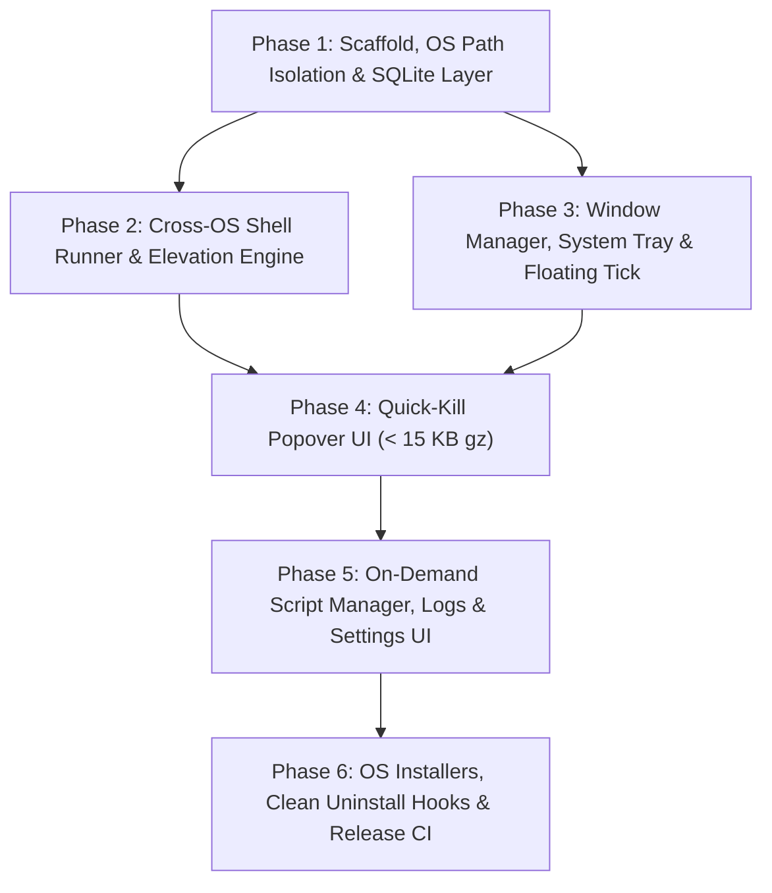

# KillEverything — Implementation Plan

This document translates [DESIGN.md](file:///Users/karson.tang/workspace/personal/kill-everything/docs/DESIGN.md) into concrete engineering milestones, crate/package dependencies, typed IPC contracts, file layouts, and verification gates.

---

## 1. Environment & Toolchain Baseline

Verified local development environment:
- **Host OS**: macOS 15.3.1 (`arm64`)
- **Rust**: `rustc 1.96.1` / `cargo 1.96.1`
- **Node / Package Manager**: `node v24.21.0` / `pnpm 12.5.1`
- **Repository Setup**: Initialize Git (`git init`) and create `.gitignore` excluding `node_modules/`, `dist/`, `src-tauri/target/`, `.DS_Store`, and local editor swap files.
- **Package Manager**: Use `pnpm` for frontend scripts/dependencies and `cargo` for `src-tauri`.

---

## 2. Dependency & Configuration Specification

### A. Rust Backend (`src-tauri/Cargo.toml`)
- **Core Tauri**:
  - `tauri = { version = "2", features = ["tray-icon", "macos-private-api"] }`
  - `tauri-build = { version = "2", features = [] }`
- **Tauri Plugins**:
  - `tauri-plugin-single-instance = "2"` (prevent duplicate tray/tick instances; focuses/toggles popover on second launch)
  - `tauri-plugin-autostart = "2"` (configured with `MacosLauncher::LaunchAgent`)
  - `tauri-plugin-global-shortcut = "2"`
  - `tauri-plugin-positioner = { version = "2", features = ["tray-icon"] }`
- **Storage, Async Runtime & Utilities**:
  - `rusqlite = { version = "0.32", features = ["bundled"] }`
  - `tokio = { version = "1", features = ["process", "time", "io-util", "sync", "rt-multi-thread", "macros"] }`
  - `serde = { version = "1", features = ["derive"] }`
  - `serde_json = "1"`
  - `uuid = { version = "1", features = ["v7"] }`
  - `chrono = { version = "0.4", features = ["serde"] }`
  - `thiserror = "2"`
- **Platform-Specific Crates**:
  - `[target.'cfg(unix)'.dependencies]`: `libc = "0.2"`
  - `[target.'cfg(target_os = "macos")'.dependencies]`: `objc2`, `objc2-app-kit`, `objc2-foundation` (for `NSWindowCollectionBehavior` and non-activating panel flags)
  - `[target.'cfg(target_os = "windows")'.dependencies]`: `windows-sys = { version = "0.59", features = ["Win32_Foundation", "Win32_System_JobObjects", "Win32_System_Threading", "Win32_UI_Shell", "Win32_UI_WindowsAndMessaging"] }`
- **Dev Dependencies**:
  - `tempfile = "3"` (isolated filesystem & SQLite tests)

### B. Frontend (`package.json` & Multi-Page `vite.config.ts`)
- **Dependencies**:
  - `@tauri-apps/api` (`^2`)
  - `@tauri-apps/plugin-autostart` (`^2`)
  - `@tauri-apps/plugin-global-shortcut` (`^2`)
  - `@tauri-apps/plugin-positioner` (`^2`)
- **Dev Dependencies**:
  - `svelte` (`^5`), `@sveltejs/vite-plugin-svelte`, `typescript`, `vite`, `svelte-check`, `@tauri-apps/cli` (`^2`)
- **Multi-Page Vite Entry Points (`vite.config.ts`)**:
  ```ts
  build: {
    rollupOptions: {
      input: {
        tick: resolve(__dirname, 'tick.html'),
        popover: resolve(__dirname, 'popover.html'),
        manager: resolve(__dirname, 'manager.html'),
      },
    },
  }
  ```
  Splitting entry points ensures `tick.html` and `popover.html` never download or parse `manager.html`'s form editor/log viewer code, keeping the Quick-Kill Popover JS payload **< 15 KB gzipped**.

### C. Tauri Capabilities (`src-tauri/capabilities/default.json`)
Explicit Tauri v2 ACL grants scoped only to `"tick"`, `"popover"`, and `"manager"`:
- `core:default`
- `core:window:allow-start-dragging`, `core:window:allow-show`, `core:window:allow-hide`, `core:window:allow-close`, `core:window:allow-set-position`, `core:window:allow-set-focus`, `core:window:allow-outer-position`, `core:window:allow-current-monitor`, `core:window:allow-available-monitors`
- `autostart:allow-enable`, `autostart:allow-disable`, `autostart:allow-is-enabled`
- `global-shortcut:allow-register`, `global-shortcut:allow-unregister`, `global-shortcut:allow-is-registered`
- `positioner:default`

---

## 3. Typed IPC Contract (`src-tauri/src/commands.rs` <-> `src/lib/ipc.ts`)

### Commands (Frontend -> Rust)
| Category | Command Signature | Notes |
|---|---|---|
| **Script CRUD** | `list_scripts() -> Vec<ScriptSummary>` | Ordered by `is_pinned DESC, sort_order ASC, name ASC` |
| | `get_script(id: String) -> Script` | Full script record for editing |
| | `save_script(input: ScriptUpsert) -> Script` | Inserts (UUID v7) or updates; emits `scripts-changed` & refreshes tray menu |
| | `delete_script(id: String) -> ()` | Cascades to `execution_logs`; emits `scripts-changed` |
| | `reorder_scripts(ordered_ids: Vec<String>) -> ()` | Transactional `sort_order` update |
| | `toggle_pin_script(id: String) -> Script` | Toggles `is_pinned`; updates tray context menu |
| **Execution & Logs** | `detect_available_shells() -> Vec<ShellInfo>` | Probes OS-available shells (`which` / standard Windows paths) |
| | `execute_script(id: String) -> ExecutionResult` | Ephemeral run, updates `run_count`/`last_run_at`/`last_exit_code`, inserts log |
| | `test_script_draft(draft: ScriptDraft) -> ExecutionResult` | Runs unsaved editor draft without touching DB metrics |
| | `get_script_logs(script_id: String) -> Vec<ExecutionLog>` | Returns up to 10 recent runs for script |
| **Settings & Backup** | `get_settings() -> AppSettings` | Returns merged defaults + stored settings |
| | `update_settings(patch: SettingsPatch) -> AppSettings` | Applies side-effects (show/hide tick, global hotkey, autostart); emits `settings-changed` |
| | `export_scripts_json() -> String` | Serializes scripts (versioned JSON envelope) |
| | `import_scripts_json(payload: String, mode: ImportMode) -> usize` | Validates & imports (`Merge` or `Replace`); returns imported count |
| **Windows & Uninstall** | `open_manager_window(route: Option<String>) -> ()` | Creates or focuses `manager` window |
| | `toggle_popover_from_tick() -> ()` | Anchors `popover` adjacent to `tick` and toggles visibility |
| | `save_tick_position(x: i32, y: i32, monitor: Option<String>) -> ()` | Persists snapped floating tick coordinates |
| | `self_uninstall() -> ()` | Wipes DB, caches, autostart, and moves macOS `.app` to Trash (if packaged), then exits |

### Backend -> Frontend Event Bus
- `scripts-changed`: Triggers instant list refresh in `popover` and `manager`.
- `settings-changed`: Syncs tick opacity/visibility and popover preferences immediately.
- `script-execution-started` (`{ scriptId }`): Shows active indicator on both `tick` and `popover`.
- `script-execution-finished` (`{ scriptId, exitCode, timedOut, durationMs }`): Updates UI badges and triggers toast/error states.

---

## 4. Phased Implementation Roadmap (6 Milestones)



### Phase 1 — Project Scaffold, OS Path Isolation & SQLite Storage Layer
- **Deliverables**:
  - Initialize Git repository, `.gitignore`, `package.json`, `tsconfig.json`, `vite.config.ts`, `src-tauri/Cargo.toml`, `src-tauri/tauri.conf.json`, and `src-tauri/capabilities/default.json`.
  - `src-tauri/src/paths.rs`: Deterministic app directories for data (`data.db`), ephemeral runner cache (`<cache>/run`), and custom Windows WebView2 `data_directory` (`%LOCALAPPDATA%\com.killeverything.app\webview`).
  - `src-tauri/src/db/`:
    - `schema.sql`: Tables `scripts`, `execution_logs`, `prune_execution_logs` trigger, `settings`.
    - `mod.rs`: Connection pool/mutex setup (`WAL`, `foreign_keys = ON`, schema migration runner).
    - `scripts_repo.rs`, `logs_repo.rs`, `settings_repo.rs`, `backup.rs` (JSON export/import).
- **Verification Gate**:
  - `cargo test --manifest-path src-tauri/Cargo.toml db::` passes 100%, verifying CRUD operations, pin/sort ordering, `prune_execution_logs` capping rows at 10 per script, settings persistence, and JSON import/export round-trips in `tempfile` DBs.

### Phase 2 — Cross-Platform Shell Execution & Privilege Elevation Engine
- **Deliverables**:
  - `src-tauri/src/executor/shells.rs`: OS shell auto-detection (`sh`, `bash`, `zsh` on Unix; `powershell.exe`, `pwsh.exe`, `cmd.exe`, Git Bash, WSL on Windows).
  - `src-tauri/src/executor/ephemeral.rs`: Writes script bytes to `<cache>/run/exec_<uuid>.<ext>` (`0700` on Unix) with RAII `Drop` cleanup guarantee.
  - `src-tauri/src/executor/runner.rs`: Async `tokio::process` runner injecting `KILL_EVERYTHING_PID`, enforcing `64 KB` bounded stream capture, Unix `process_group(0)` + `killpg` timeout termination, and Windows `CREATE_NO_WINDOW` + Job Object `KILL_ON_JOB_CLOSE`.
  - `src-tauri/src/executor/elevate.rs`: macOS `osascript ... with administrator privileges`, Linux `pkexec`, Windows `ShellExecuteExW` (`"runas"`, `SW_HIDE`, ephemeral `.log` capture + RAII cleanup).
- **Verification Gate**:
  - `cargo test --manifest-path src-tauri/Cargo.toml executor::` passes all unit/integration tests:
    - Exit `0` stdout capture; non-zero exit `stderr` capture.
    - Ephemeral file guaranteed removed after both normal completion and forced timeout.
    - Spawning a child sleeping process with `1s` timeout kills the entire process group promptly and sets `timed_out = true`.

### Phase 3 — Window Manager, System Tray & Floating Desktop Tick
- **Deliverables**:
  - Single-instance plugin integration (`tauri-plugin-single-instance`).
  - `src-tauri/src/windows/tray.rs`: Native System Tray icon with left-click popover toggle and dynamically rebuilt right-click menu (pinned scripts execute immediately when clicked).
  - `src-tauri/src/windows/tick.rs`: `40×40px` frameless transparent `always_on_top` window with macOS `ActivationPolicy::Accessory` + `NSPanel`/`CanJoinAllSpaces` and Windows `WS_EX_TOOLWINDOW | WS_EX_NOACTIVATE`.
  - `src-tauri/src/windows/popover.rs`: Smart screen-edge anchoring near tray icon or tick, hide-on-blur, and global shortcut toggle (`tauri-plugin-global-shortcut`).
  - `src-tauri/src/windows/manager.rs`: Lazy creation and full window destruction (`close()`) on exit.
  - `src/windows/tick/TickApp.svelte`: Drag vs. click threshold (`< 4px`), magnetic `16px` screen-edge snap, idle/hover opacity, and position persistence via `save_tick_position`.
- **Verification Gate**:
  - `cargo check --manifest-path src-tauri/Cargo.toml` and `pnpm check` pass cleanly.
  - Launching `pnpm tauri dev` displays menu bar icon (hidden from Dock on macOS) + draggable floating tick that never steals foreground focus and cleanly toggles `popover`.

### Phase 4 — Quick-Kill Popover UI
- **Deliverables**:
  - `src/lib/ipc.ts`: Complete TypeScript bindings matching `commands.rs` and event listeners.
  - `src/windows/popover/PopoverApp.svelte`: Minimal high-contrast UI with search filter, keyboard navigation (`↑/↓`, `Enter`, `Esc`), pinned section divider, 1-click **[Kill]** button, inline confirmation strip when `confirm_before_run = true`, live spinner -> `✓ <ms>` / `⚠ Exit N`, expandable inline error log drawer, and header quick buttons (`+ New`, `⚙`).
- **Verification Gate**:
  - `pnpm build` succeeds and `dist/assets/popover-*.js` is verified **< 15 KB gzipped**.
  - End-to-end execution of passing and failing test scripts from the popover updates inline status, emits events, and records logs in SQLite.

### Phase 5 — On-Demand Script Manager, Logs & Settings UI
- **Deliverables**:
  - `src/windows/manager/ManagerApp.svelte` with 3 clean tabs:
    - **Scripts Tab**: CRUD list (create, edit, duplicate, pin, drag-reorder, delete), dynamic OS shell dropdown, monospaced script editor, elevated/confirmation toggles, timeout input, and live **[Test Run]** panel.
    - **Logs Tab**: Per-script / recent execution log inspector (`started_at`, `duration_ms`, `exit_code`, `timed_out`, `stdout`, `stderr`).
    - **Settings & Uninstall Tab**: Show/hide Floating Tick, tick opacity slider, global hotkey recorder, Launch at Login toggle (`tauri-plugin-autostart`), close-popover-after-kill toggle, JSON Export/Import, and *Uninstall & Wipe All App Data* with confirmation dialog.
- **Verification Gate**:
  - `pnpm check` and `cargo test --manifest-path src-tauri/Cargo.toml` pass.
  - Interactive manual verification confirms CRUD persistence, Test Run live output, instant sync with Tray & Popover, JSON export/import, and memory drop when closing Manager.

### Phase 6 — Native OS Installers, Clean-Uninstall Hooks & Release CI
- **Deliverables**:
  - **Windows**: `src-tauri/installer/windows/hooks.nsh` (`NSIS_HOOK_PREUNINSTALL`) wired into `tauri.conf.json` (`bundle.windows.nsis.installerHooks`).
  - **Linux**: `src-tauri/installer/linux/prerm` and `postrm` wired into `tauri.conf.json` (`bundle.linux.deb` and `bundle.linux.rpm`), plus `--uninstall-clean` CLI flag handling in `main.rs`.
  - **macOS**: `src-tauri/src/uninstall/macos_watcher.rs` installing `~/Library/LaunchAgents/com.killeverything.cleaner.plist` (`WatchPaths` with `2s` update-debounce, active strictly when `!cfg!(debug_assertions)` inside a `.app` bundle) + in-app `self_uninstall` implementation.
  - **Icons**: App icon assets (`32x32.png`, `128x128.png`, `128x128@2x.png`, `icon.icns`, `icon.ico`, monochrome `trayTemplate.png` for macOS).
  - **CI Pipeline**: `.github/workflows/release.yml` building `.dmg` (macOS `arm64`/`x64`), NSIS `-setup.exe` (Windows `x64`/`arm64`), and `.deb` + `.rpm` (Linux `x64`).
- **Verification Gate**:
  - `pnpm tauri build` succeeds cleanly on macOS producing `.app` and `.dmg`.
  - Binary/DMG size verified; cleanup scripts tested against isolated temporary home/app directories confirming 100% deletion of SQLite DB, caches, and autostart entries with zero collateral impact.

---

## 5. Risks & Mitigations

| Risk | Impact | Mitigation |
|---|---|---|
| **Wayland blocks global window coordinates** | Floating Tick cannot freely position on strict Wayland desktops | Use `gtk-layer-shell` where supported, fallback to XWayland (`GDK_BACKEND=x11`), and keep System Tray (`libayatana-appindicator`) + Global Hotkey as first-class triggers. |
| **macOS in-place app upgrade fires `WatchPaths`** | Replacing `/Applications/KillEverything.app` could delete user scripts | `launchd` cleaner script waits `2s` and verifies `[ ! -e "$APP_PATH" ]` before wiping any directory. |
| **Dev builds register macOS Trash-watcher** | Deleting `target/debug` could wipe dev config | Register `com.killeverything.cleaner.plist` strictly when `!cfg!(debug_assertions)` AND `current_exe()` is inside a `.app` bundle. |
| **Windows UAC breaks stdout/stderr pipe inheritance** | Elevated scripts wouldn't show failure logs | Redirect elevated output to `<cache>/run/exec_<uuid>.log`, wait for handle, read log, and delete via RAII `Drop`. |
| **Runaway user kill script hangs forever** | Zombie background processes or locked UI | Every spawn runs asynchronously in a dedicated Unix process group or Windows Job Object with configurable timeout (default `15s`) hard-killing the entire tree. |
